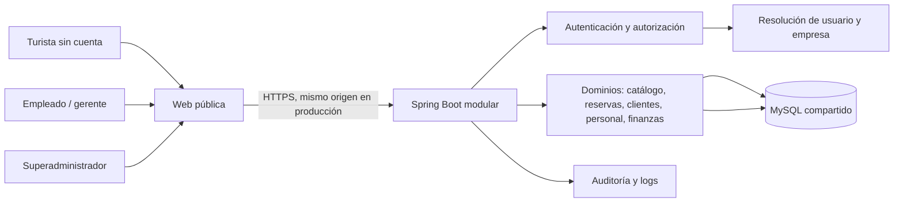

# Arquitectura objetivo y plan de transición — Mi Guía Turístico

**Evaluación documental:** 19 de noviembre de 2026  
**Proyecto:** C:\Users\luisg\Desktop\Proyectos\MiGuiaTuristico_v2

## 1. Resumen ejecutivo

La ruta de menor reconstrucción es conservar Java/Spring Boot, MySQL, HTML/CSS/JavaScript y Playwright, evolucionando el backend hacia una API autenticada y multiempresa. Mantener el frontend por ahora: las páginas y módulos existentes ya cubren partes de los flujos operativos. Antes de añadir muchas pantallas, establecer identidad, autorización por empresa, migraciones versionadas, límites de acceso consistentes y pruebas de seguridad.

La propuesta multi-tenant de una aplicación, un backend y una base MySQL compartida es adecuada para el tamaño inicial. Cada tabla empresarial debe llevar tenant_id/id_negocio y las consultas, referencias y mutaciones deben quedar acotadas a la empresa autorizada en el servidor. El identificador nunca debe derivarse de un query/body confiado. El superadministrador tendrá permiso global separado, auditable y deliberadamente explícito.

**Aclaración sobre aislamiento actual:** la guía anterior advertía que debía verificarse. La inspección directa muestra que servicios sí filtra listados por el negocio activo y valida propiedad al leer, editar y borrar; reservas y costos también usan ese contexto. Clientes igualmente comprueba su ámbito. Esto es un límite correcto para el modo local de un negocio, no un aislamiento multiusuario: NegocioActivoService selecciona un ID global de configuración, no el negocio asociado al usuario autenticado. No se encontró autenticación ni Spring Security en el código/dependencias inspeccionadas. Por tanto, no afirmar que los CRUD actuales ya son seguros para SaaS.

No se ejecutó código, migración ni prueba; no se alteró base, configuración ni dependencias. La evaluación es documental y no verificó esquema/contenido real de MySQL.

## 2. Arquitectura recomendada

Mantener inicialmente un monolito modular Spring Boot y una base MySQL compartida. No separar microservicios antes de que el volumen/equipos lo justifiquen. Separar paquetes por dominio y capas internas (web/controller, application/service, persistence/repository, domain/model, security). Usar DTOs de entrada/salida, no exponer entidades JPA como contrato público.

Los paneles pueden ser áreas/rutas de una misma interfaz y compartir componentes, estilos, cliente API y sesión. En producción conviene servir frontend y API bajo un origen (Spring static/proxy/reverse proxy); esto simplifica cookies y CORS. En desarrollo se pueden conservar 3000/8080. Mantener MySQL 3306 local.

## 3. Usuarios, roles y permisos

Separar **rol de plataforma** y **membresía empresarial**:

- Usuario: identidad global (email normalizado, estado, credencial externa/hash, timestamps).
- Empresa: organización/tenant y estado (pendiente, activa, suspendida, cerrada).
- Membresía: usuario + empresa + estado; permite que un usuario pertenezca a más de una empresa si el producto luego lo requiere.
- Rol y permiso: catálogo de capacidades; asignación de rol a membresía o usuario plataforma.
- Rol global SUPERADMIN no requiere empresa; su autorización global debe ser una ruta explícita, revisada y auditada.
- Roles de empresa: GERENCIA, CONTADOR_ADMIN, GUIA_RECEPCIONISTA. Resolver permisos en servidor. Una matriz de permisos explícita evita que el nombre del rol se convierta en lógica dispersa.

Permisos iniciales orientativos: clientes/servicios/reservas/calendario para guía; además costos/reportes financieros para contador; todo lo empresarial, personal y configuración para gerencia. Turistas no necesitan sesión en primera versión para consultar catálogo/crear solicitud pública. Limitar abuso con validación, rate limit y verificación de disponibilidad; no darles acceso a APIs privadas.

Empleados desactivados se marcan inactivos; no borrado en cascada. Conservar reservas, actividades, asignaciones y auditoría histórica, guardando actor/empleado referenciado aunque ya esté desactivado.

## 4. Multiempresa e integridad

Una base compartida es razonable mientras el sistema sea pequeño/mediano y las empresas no requieran aislamiento contractual dedicado. Ventajas: operación simple, migraciones coordinadas y costos bajos. Riesgo: error de filtro puede exponer datos cruzados. Mitigaciones:

1. Resolver empresa activa desde el principal autenticado y una membresía autorizada; validar cada cambio de empresa.
2. Colocar tenant_id en cada agregado/dato propiedad de empresa y en claves de referencias donde sea viable.
3. Consultar registros por (tenant_id, id), no recuperar por ID global y “recordar” comprobar luego; validar que cliente, servicio, categoría, empleado y reserva relacionados pertenezcan al mismo tenant.
4. Eliminar idNegocio del payload como fuente autoritativa. Si se recibe por compatibilidad, compararlo con el ámbito de sesión y rechazar diferencias.
5. Pruebas negativas entre dos empresas para listar/leer/crear/editar/borrar y para IDs relacionados.
6. No mezclar dashboard global en consultas empresariales. Endpoints de superadmin dedicados, permisos separados y log obligatorio.
7. Evaluar más adelante RLS/DB separada por cliente solo por requisito de cumplimiento, contratos o escala; no hace falta para la primera versión.

Actualmente las entidades incluyen idNegocio en varios registros y repositorios filtran; NegocioActivoService usa configuración única. No se revisó cada query/repositorio ni el esquema físico completo. Auditoría de todos los dominios y datos existentes es prerrequisito de migración.

## 5. Autenticación y sesiones

Para esta web operativa recomiendo sesiones de servidor con cookie de sesión HttpOnly, Secure en producción y SameSite=Lax/Strict según flujos. Añadir protección CSRF a operaciones mutables y expiración/logout. Evitar tokens persistentes en localStorage. Con una sola interfaz navegador y backend propio, las sesiones permiten revocación sencilla y reducen complejidad.

Spring Security es la opción natural en Spring Boot, con autenticación de contraseña usando hashing adaptativo (Argon2id o BCrypt según soporte/operación), limitación de intentos, recuperación segura y MFA al menos obligatorio/recomendado para superadmin. Si se usa proveedor OIDC gestionado, delegar inicio de sesión y MFA allí; mantener autorización de empresa en la aplicación. JWT solo resulta preferible si aparecen clientes móviles/terceros con necesidad real de API stateless; en ese caso access tokens breves y refresh/revocación bien diseñados. No usar una solución propia de criptografía.

Con frontend actualmente en 3000 y API en 8080, solicitudes con cookies cross-origin requieren credentials y CORS exacto; evaluar esto en desarrollo. No usar comodín de origen con credenciales. Producción bajo mismo origen simplifica el modelo.

## 6. Modelo conceptual de datos

| Entidad | Estado observado | Objetivo/relaciones |
|---|---|---|
| Empresa/Negocio | Repositorio/consultas y contexto, esquema no verificado | Estado, slug/dominio, plan; raíz de datos tenant |
| Usuario | No observado | Identidad única, estado, credencial/proveedor |
| Membresía | No observada | Usuario ↔ empresa, estado, rol |
| Rol/Permiso | No observado | Catálogo de capacidades y asignaciones |
| Cliente | Entidad existente con idNegocio | Empresa propietaria; historial de reservas |
| Servicio/Categoría | Servicio y repositorio de categorías observados | Empresa propietaria; precio/publicación/versionado necesario |
| Reserva | Entidad/servicio existentes; DTOs | Empresa, cliente y servicio de misma empresa; estado, fechas, solicitante |
| Actividad | Entidad y servicio existentes | Empresa, fecha/estado y asignaciones de empleados |
| Empleado | No entidad identificada | Modelar como usuario con membresía/perfil laboral; no duplicar identidad |
| Asignación | No observada | Actividad/reserva ↔ empleado, empresa y rol operativo |
| Evaluación | No observada | Evaluador, evaluado, experiencia/operación, consentimiento y privacidad |
| Costo | Entidad/servicio existentes | Empresa, categoría, actor y auditoría |
| Ingreso/Pago | No observado como módulo dedicado | Definir libro transaccional, moneda, estado y referencias; no inferir solo de reserva |
| Suscripción/Plan | No observado | Plan, periodo, estado, proveedor y eventos idempotentes |
| Página pública | No observada | Perfil público por empresa, slug, contenido publicado |
| Solicitud pública | No observada como dominio separado | Entrada sin cuenta, empresa/servicio, consentimiento, spam/status |
| Reseña | No observada | Reserva/experiencia verificable, estado de moderación |
| Auditoría | No observada | actor, empresa nullable para acciones globales, acción, entidad, fecha, correlación y cambios mínimos |

Mantener claves foráneas e índices tenant-first para consultas frecuentes, unicidad compuesta donde aplique (por ejemplo slug global y nombres/códigos dentro de empresa según regla de negocio). Diseñar soft-deactivation para usuarios/empleados y conservar trazabilidad financiera. Confirmar precisión monetaria, zonas horarias, política de retención y borrado de datos personales antes de definir migraciones.

## 7. Organización de módulos

- **Área pública:** páginas de empresas/servicios y formularios públicos; solo datos publicados. Sin sesión obligatoria.
- **Área empresarial:** módulos ya existentes (dashboard, servicios, clientes, reservas, calendario, costos, reportes); menú filtrado por permisos.
- **Área personal:** perfil/agenda y asignaciones del empleado. Puede compartir shell empresarial con vistas recortadas.
- **Área plataforma:** interfaz propia visualmente coherente para empresas, planes, suscripciones, incidentes y auditoría global; endpoints globales separados y sin tenant implícito.

La estructura actual de HTML multipágina y CSS/JS compartido puede soportar una primera evolución: añadir rutas/páginas por área, componentes comunes y gates de permisos. A medida que estados compartidos entre pantallas crezcan, evaluar migración incremental a un framework (React no es requisito). No reescribir para SaaS antes de arreglar contratos y seguridad. Añadir módulos JS compartidos para navegación, controles visuales, mensajes y formularios donde la duplicación se confirme. El servidor Python es solo estático local; para producción usar hosting estático/proxy adecuado y HTTPS.

## 8. Seguridad y mantenimiento

Prioridades: Spring Security y denegación por defecto; autorización de backend en cada endpoint; sesión/CSRF; aislamiento tenant verificado; validación DTO; respuestas de error uniformes sin stack traces; protección de datos personales; auditoría de acciones de empresa/superadmin y finanzas; secretos fuera del repositorio y gestor de secretos en producción; backups cifrados con pruebas de restauración; logs estructurados sin contraseñas/tokens/datos sensibles; límites/rate-limiting en endpoints públicos; CORS restrictivo; política de retención.

Pruebas esenciales: permisos por rol, tenant A vs tenant B, IDs cruzados en relaciones, superadmin global, usuario inactivo, CSRF/sesión, flujos de reserva y solicitudes públicas, restauración de backup y migración desde copia. Playwright cubre UX crítica; pruebas de integración de backend verifican seguridad con base aislada. No se debe considerar evidencia de pruebas existentes como cobertura suficiente sin ejecutarlas y medirla.

## 9. Matriz actual/futuro

| Componente | Situación actual verificada | Situación deseada | Trabajo necesario | Prioridad |
|---|---|---|---|---|
| Frontend | HTML/CSS/JS y páginas funcionales parciales | áreas pública, empresa y plataforma compartidas | mantener, extraer componentes al crecer | Media |
| Backend | Spring Boot MVC/JPA, CRUD parciales | monolito modular con contratos DTO | ordenar dominios y servicios | Alta |
| Base de datos | MySQL configurado; esquema no conectado/verificado | tenant IDs, integridad y migraciones | inventariar esquema/datos y Flyway | Crítica |
| Multiempresa | ID de negocio global por configuración; filtros/propiedad en varios CRUD | contexto por identidad autenticada | convertir resolución y auditar cada endpoint | Crítica |
| Autenticación | No identificada | Spring Security/sesión o OIDC | identidad, login, recuperación, MFA admin | Crítica |
| Roles | No identificados | permisos plataforma y por membresía | matriz, entidades y enforcement | Crítica |
| Superadmin | No identificado | panel y APIs globales auditadas | construir tras auth/auditoría | Alta |
| Empleados | No modelo identificado | usuario + membresía, baja lógica y asignaciones | construir modelo/flujo | Alta |
| Reservas | CRUD/estado, validación de negocio existente | reserva pública/privada y ciclo auditable | preservar; endurecer concurrencia y tenant | Alta |
| Finanzas | Costos/resumen; ingresos/pagos no identificados | permisos y registros financieros coherentes | definir modelo contable/producto | Alta |
| Sitios públicos | No identificados | páginas publicadas y solicitudes anónimas | construir con limitación/antiabuso | Media |
| Seguridad | CORS y validación; auth no identificada | defensa por defecto y auditoría | implementar transversalmente | Crítica |
| Pruebas | Algunas pruebas Java/Playwright presentes | cobertura de aislamiento, permisos e integración | diseñar y ampliar por fase | Crítica |

CRUD y artefactos existentes se consideran implementación parcial, no producción SaaS verificada.

## 10. Riesgos técnicos

- **Exposición cruzada:** contexto global configurable no separa sesiones/usuarios; no abrir SaaS externo antes de migrarlo a principal autenticado.
- **Esquema desconocido:** no hay inspección de BD ni migraciones; riesgo de inferir relaciones/estado de datos incorrectamente.
- **Contrato/API:** frontend depende de nombres/campos actuales; endurecer DTOs con compatibilidad o transición planificada.
- **Finanzas:** costo e ingresos no equivalen a contabilidad completa; acordar reglas de pago, devolución, moneda e impuestos.
- **Concurrencia:** disponibilidad de reservas requiere prueba ante solicitudes simultáneas.
- **Cuenta pública:** spam, privacidad y consentimiento requieren diseño.
- **Operación:** faltan evidencia de backups restaurables, despliegue, monitoreo y gestión de secretos de producción.
- **Cambio visual/framework:** migración total prematura consumiría esfuerzo y arriesgaría módulos sin solucionar seguridad.

## 11. Hoja de ruta y dependencias

### Fase 0 — Descubrimiento y línea base
**Objetivo:** conocer estado real antes de cambiar datos. Inventariar esquema MySQL con respaldo, restricciones, filas huérfanas, IDs negocio, contratos HTTP y flujos. Archivos: configuración/modelos/repositorios/tests y documentación. BD: solo lectura. Pruebas: snapshot funcional y de datos. Riesgo: diferencias con guía. Resultado: mapa aprobado de datos y criterios de aceptación.

### Fase 1 — Fundamentos de datos y migración
**Objetivo:** cambios reproducibles. Introducir Flyway con baseline controlado del esquema existente, respaldos y ensayo de migración sobre copia. Crear esquema para usuarios/membresías/roles solo tras confirmar columnas y mapear datos. Archivos: pom/configuración, migraciones versionadas, repositorios. Dependencia: fase 0. Riesgo: baseline incorrecto o pérdida de datos. Pruebas: migración vacía y desde copia; rollback/restauración. No aplicar a datos productivos sin ensayo.

### Fase 2 — Identidad y seguridad
**Objetivo:** sesión real y permisos cerrados por defecto. Incorporar Spring Security, credenciales/proveedor, login/logout, cookies, CSRF, recuperación, MFA para superadmin. Ninguna API privada anónima. Archivos: config, controladores, cliente API y pantallas login. BD: usuario/credencial/auditoría. Dependencias: modelo de fase 1. Pruebas: login, revocación y matriz de permisos. Riesgo: lockout; preparar administrador bootstrap seguro.

### Fase 3 — Tenant y membresías
**Objetivo:** eliminar negocio global estático como autoridad. Resolver empresa del principal/membresía; consultas tenant-scoped; separar APIs superadmin. Archivos: NegocioActivoService y todos controladores/servicios/repositorios. BD: membresía y FKs/índices tenant. Pruebas exhaustivas A/B incluyendo relaciones y métodos mutables. Dependencia: fases 1–2. Riesgo: incompatibilidad de datos actuales; migración de negocio dueño. No abrir onboarding público hasta pasar esta fase.

### Fase 4 — Roles y operaciones internas
**Objetivo:** empleados, guías, contador y gerencia. Alta/invitación, asignación de roles, desactivación sin borrar historia, asignaciones. Archivos: dominios usuario/membresía/personal, calendario y páginas del panel. BD: roles/permisos/asignaciones. Pruebas de capacidades y conservación histórica. Dependencia: fase 3.

### Fase 5 — Comercial SaaS y portal público
**Objetivo:** planes/suscripción, página pública y solicitud sin cuenta. Añadir idempotencia y controles de abuso; revisión/moderación de reseñas verificadas. BD: planes, suscripción, eventos, slug, solicitudes y reseñas. Dependencias: tenant/seguridad. Riesgo: exposición de datos privados y spam. Pruebas públicas/privadas y pagos simulados antes de proveedor real.

### Fase 6 — Administración y operación
**Objetivo:** superadmin, soporte y preparación comercial. Panel global, activar/suspender empresa, auditoría, errores operativos, monitorización, backups/restores, despliegue HTTPS y políticas de retención. BD: auditoría y planes consolidados. Dependencias: auth/tenant. Pruebas de privilegios globales, restauración, despliegue y carga según metas.

En todas las fases preservar rutas existentes mediante adaptadores/DTO o cambios versionados; no activar despliegue multiempresa hasta superar la matriz de acceso cruzado.

## 12. Decisiones técnicas recomendadas

1. **HTML/CSS/JS vs React:** conservar por ahora. La app es pequeña y multipágina; una reescritura no resuelve los riesgos de tenant. Revaluar React cuando la complejidad de estado/componentes compartidos y el costo de duplicación se demuestren.
2. **Multi-tenant:** sí, base compartida y tenant lógico. Contexto siempre derivado de identidad/membresía en backend.
3. **Autenticación:** sesión server-side + cookie HttpOnly/Secure/SameSite y CSRF para navegador; OIDC gestionado puede cubrir credenciales/MFA. No localStorage JWT.
4. **Roles:** permiso explícito por rol, global separado de membresía empresarial, denegación por defecto.
5. **Superadmin:** área/rutas separadas sobre misma plataforma, endpoints globales marcados, MFA y auditoría; nunca simular empresa ordinaria.
6. **Duplicación:** cliente API común y componentes JS/CSS compartidos; extraer por repetición real, no crear framework propio grande.
7. **Datos:** tenant en datos empresariales, FK compuestas/validación de relaciones, baja lógica para usuarios, transacciones e índices por tenant.
8. **Antes de features:** confirmar esquema/datos, migraciones Flyway sobre copias, seguridad, pruebas cruzadas y auditoría de endpoints.

Flyway es apropiado porque hoy ddl-auto=validate valida pero no versiona ni aplica cambios. Incorporarlo con baseline y revisión manual del esquema preexistente; no generar una migración inicial a ciegas ni apuntar directamente a la base operativa.

## 13. Decisiones que requieren aprobación del producto

- ¿Un usuario podrá trabajar para varias empresas?
- ¿Registro de empresas será abierto, invitado o aprobado por superadmin?
- ¿Proveedor OIDC o cuentas locales; MFA obligatorio para todos los gerentes?
- ¿Qué operaciones financieras constituyen “ingreso” y cómo se tratan pagos, impuestos y reembolsos?
- ¿Cuándo se elimina/anonomiza información personal y reservas?
- ¿Planes/suscripciones se cobrarán dentro del sistema desde el primer lanzamiento?
- ¿Qué datos y reportes podrá ver exactamente el superadministrador y con qué motivo/auditoría?

## Respuesta final

La arquitectura más adecuada es un **monolito modular SaaS multi-tenant** con Spring Boot y MySQL compartido, autenticación de sesión segura, permisos en servidor y tenant derivado de la membresía autenticada; mantener el frontend actual y evolucionarlo por áreas; gestionar el esquema con Flyway; y priorizar seguridad, integridad y pruebas de aislamiento antes de abrir registro público o añadir módulos comerciales. Así se conserva la mayor parte del trabajo actual y se evita reconstruir la interfaz antes de resolver los riesgos que realmente impiden comercializarla.

